<p align="center">
  
</p>

<p align="center">
  <a href="https://github.com/MuskaanDhanda">
    
  </a>
</p>

<p align="center">
  <a href="https://www.linkedin.com/in/muskaan-dhanda-164378180"></a>
  <a href="mailto:muskaan.engineer@gmail.com"></a>
  <a href="https://github.com/MuskaanDhanda/DevOps-Assignments"></a>
  <a href="https://github.com/MuskaanDhanda/AWS-Assignments-and-Projects"></a>
</p>

<p align="center">
  
  
  
  
</p>

---

### 👩‍💻 About Me

<p align="center">
  
</p>

---

### 🛠️ Tech Stack

<p align="center">
  <a href="#"></a><br/>
  <a href="#"></a><br/>
  <a href="#"></a>
</p>

<details>
<summary><b>🔍 Click to see the full skills breakdown</b></summary>
<br/>

| Area | Skills |
|------|--------|
| 🔁 **CI/CD & Release** | Jenkins pipelines, Continuous Integration & Delivery, build automation, release management |
| 🐳 **Containers** | Docker, Docker Hub, Kubernetes (K8s), Amazon EKS |
| 🏗️ **Infrastructure as Code** | Terraform, Terraform deployments through CI/CD |
| ⚙️ **Configuration Mgmt** | Ansible playbooks |
| ☁️ **AWS** | EC2, EKS, RDS, Aurora, DynamoDB, storage |
| ☁️ **Azure** | Virtual Machines, VM Scale Sets, Automation Accounts, Storage |
| 🐧 **Linux Admin** | LVM, SELinux, firewall, Samba, DNS/DHCP, troubleshooting & log analysis |
| 🐍 **Scripting** | Python automation scripts, Bash |
| 🖥️ **Virtualization** | KVM, Hyper-V, VMware ESXi, XEN, OpenStack |
| 📈 **Operations** | Monitoring & alerting, incident management, patch management, SOPs, cost optimization |
| 🔐 **DevSecOps** | Firewall configuration, SELinux |

</details>

---

### 🚀 Featured Projects

<p align="center">
  <a href="https://github.com/MuskaanDhanda/DevOps-Assignments"></a>
  <a href="https://github.com/MuskaanDhanda/AWS-Assignments-and-Projects"></a>
</p>

<details>
<summary><b>⚙️ Jenkins CI/CD pipeline to Amazon EKS</b></summary>
<br/>

```text
GitHub ──▶ Jenkins ──▶ Docker build ──▶ Docker Hub ──▶ Kubernetes on Amazon EKS
```
A Jenkins pipeline that pulls code from GitHub, builds a Docker image, pushes it to Docker Hub and deploys the app to an EKS cluster.
</details>

<details>
<summary><b>🏗️ Infrastructure as Code with Terraform</b></summary>
<br/>

Terraform configurations that provision cloud infrastructure, so environments can be created, changed and destroyed the same repeatable way.
</details>

<details>
<summary><b>📜 Configuration management with Ansible</b></summary>
<br/>

Ansible playbooks that install and configure software on Linux servers automatically. See the [Ansible folder](https://github.com/MuskaanDhanda/DevOps-Assignments/tree/main/Ansible).
</details>

<details>
<summary><b>🗄️ AWS databases: RDS, Aurora and DynamoDB</b></summary>
<br/>

MariaDB on RDS connected from Windows and Linux clients, Aurora with read replicas across availability zones, and a DynamoDB table with backup and restore. See the [AWS repo](https://github.com/MuskaanDhanda/AWS-Assignments-and-Projects/tree/main/assignments).
</details>

---

### 💼 Experience

<details open>
<summary><b>Cloud Engineer — Coforge, Greater Noida</b> · Jun 2021 – Mar 2024</summary>
<br/>

- Supported Azure and AWS infrastructure for three enterprise clients: Colt-DCS, Aldermore and Advantage-GO TTC
- Automated deployment tasks with Python, cutting deployment time and manual errors
- Owned monitoring and alert management during hypercare, triaging and resolving incidents
- Wrote SOPs for patch management and Azure Automation Accounts
- Administered Linux servers: LVM, SELinux, firewall, DNS/DHCP, troubleshooting
</details>

<details>
<summary><b>DevOps Upskilling — iHUB DivyaSampark, IIT Roorkee</b> · 2026 – Present</summary>
<br/>

- Executive PG Certification in Cloud Computing & DevOps (expected Dec 2026)
- Hands-on with Jenkins, Docker, Kubernetes, Amazon EKS, Terraform and Ansible
</details>

---

### 📊 GitHub Activity

<p align="center">
  
  
</p>

<p align="center">
  
</p>

---

<p align="center">
  <i>"Automate the boring, monitor the critical, document everything."</i><br/><br/>
  <b>Let's connect — I'm open to DevOps & Cloud roles 🤝</b>
</p>

<p align="center">
  
</p>
